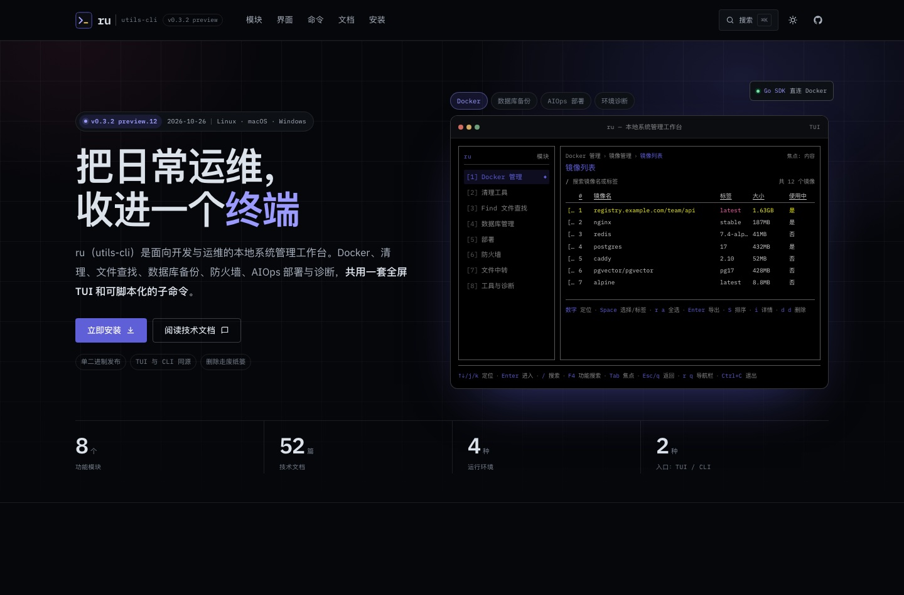

# ru 展示站

面向当前仓库项目 `ru`（utils-cli）的静态展示网站：介绍这个本地系统管理工作台的功能模块、TUI 界面、CLI 入口、安装方式、平台边界与技术文档。

> 站点是仓库的展示页，不是发布说明，也不替代官方文档。项目功能、命令与平台边界以仓库 `README.md` 和 `docs/` 为准。



## 本地预览

站点需要和仓库 `docs/` 在同一台静态服务器下，文档阅读页才能读取 Markdown 原文。请在**仓库根目录**启动服务：

```bash
cd utils-cli
python3 -m http.server 4173
# 打开 http://127.0.0.1:4173/showcase/
```

也可以直接打开 `showcase/index.html`，但文档阅读页的 Markdown 抓取会受浏览器 `file://` 限制；此时仍可使用“下载 Markdown”。

## 页面

| 文件 | 内容 |
| --- | --- |
| `index.html` | 首页：Hero TUI 预览、8 个功能模块、工作方式、真实界面截图、CLI、安装、平台矩阵、文档与 CTA |
| `docs.html` | 技术文档索引：4 个分组、52 篇文档，支持标题/简介/文件名筛选与分组定位 |
| `doc.html` | 文档阅读页：按 `file` 参数读取 `docs/` 下的 Markdown 原文，按 UTF-8 解码展示 |
| `assets/js/data.js` | 文档索引数据（标题、简介、文件路径、分组） |
| `assets/js/site.js` | 主题、TUI 预览切换、CLI/安装标签、命令面板、复制、截图查看与文档筛选 |

## 交互

- **深色 / 浅色主题**：默认深色，切换结果保存在 `localStorage`。
- **TUI 预览**：Docker、数据库备份、AIOps 部署、环境诊断四组视图；点击左侧模块或顶部标签切换。
- **命令行**：Docker / 数据库 / AIOps / 诊断 / 工具五组命令，支持一键复制（自动去掉提示符）。
- **安装命令**：Unix / Windows 安装器切换与复制，附离线安装说明。
- **命令面板**：`⌘K` / `Ctrl+K` 搜索页面、模块、命令与 52 篇文档；`/` 在文档页聚焦筛选框。
- **截图查看**：点击 TUI 截图打开大图查看器（`Esc` 关闭）。
- **文档索引**：按关键字过滤文档卡片，侧栏随滚动高亮分组，支持 `docs.html#group-*` 深链。
- **文档阅读**：从索引进入 `doc.html?file=...`，浏览器读取并展示 Markdown 源文，可下载原文。

## 内容来源

- 功能、命令、平台矩阵与版本信息来自仓库 `README.md`、`docs/README.md`、`docs/platform-support.md` 和 `docs/release-workflow.md`。
- 文档索引条目来自 `docs/` 文件清单与 `docs/README.md` 的分组；描述为便于索引而做的摘要。
- 首页三张 TUI 截图来自仓库 `build/` 下的 TUI 预览帧（`table-preview/table.png`、`debug/layout-preview.png`、`style-preview/palette.png`），使用演示数据，不是运行时实时抓屏。
- 当前展示版本为 `v0.3.2-preview.12`（2026-10-26）；GitHub Releases 上的最新正式版为 `v0.2.6`。

## 技术说明

- 纯静态 HTML/CSS/JavaScript，无构建步骤、无前端框架、无 CDN。
- 字体为本地 IBM Plex Sans / IBM Plex Mono，SIL OFL 1.1，许可证见 `assets/fonts/licenses/`。
- 站点不收集数据、不请求第三方资源；GitHub Releases 与文档下载是显式外链。
- 文档阅读页依赖同源 `fetch('../docs/...')`，因此建议通过本地 HTTP 服务预览。

## 维护提示

- 版本号、模块数量、文档数量与截图说明在 `index.html`、`docs.html`、`doc.html` 和 `assets/js/data.js` 中；更新文档清单时同步修改 `data.js` 与索引页的分组计数。
- 文档阅读页只展示 Markdown 源文，不做 Markdown 渲染；如需正式文档站，请以 `docs/README.md` 为入口继续扩展。
