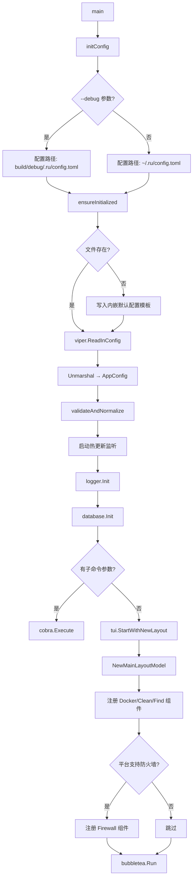
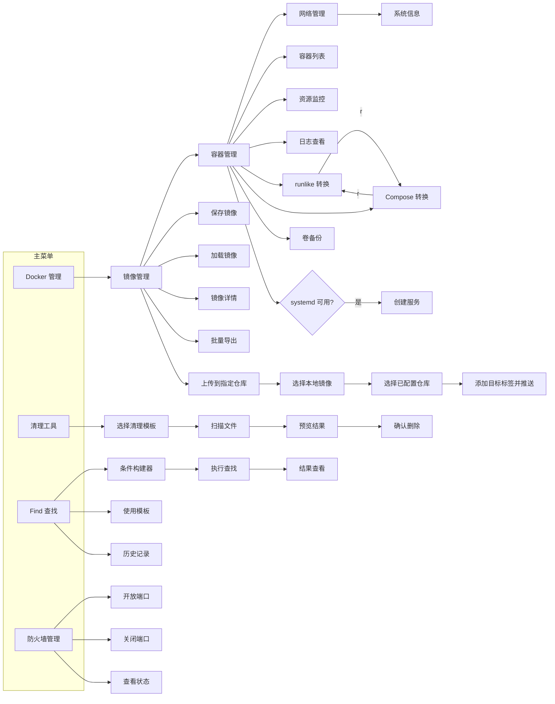
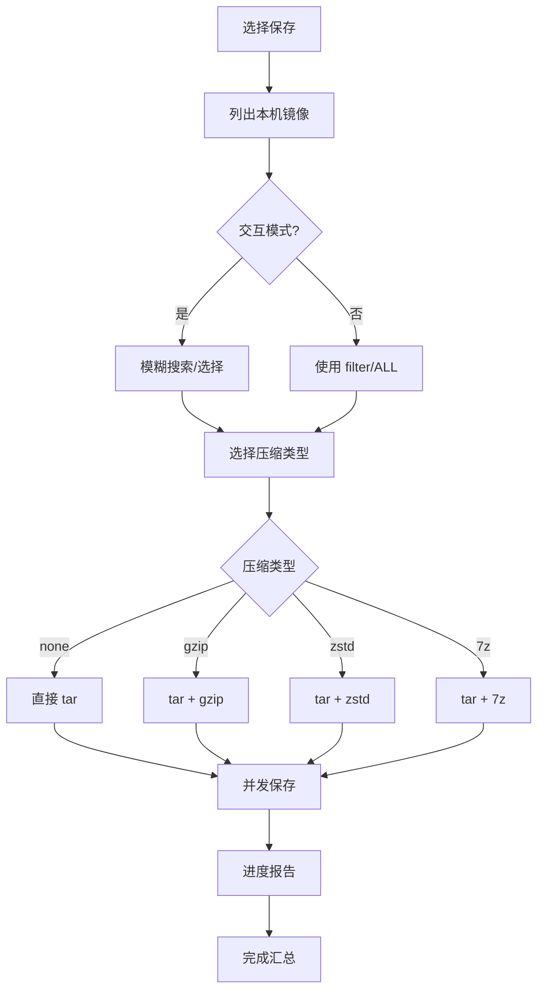
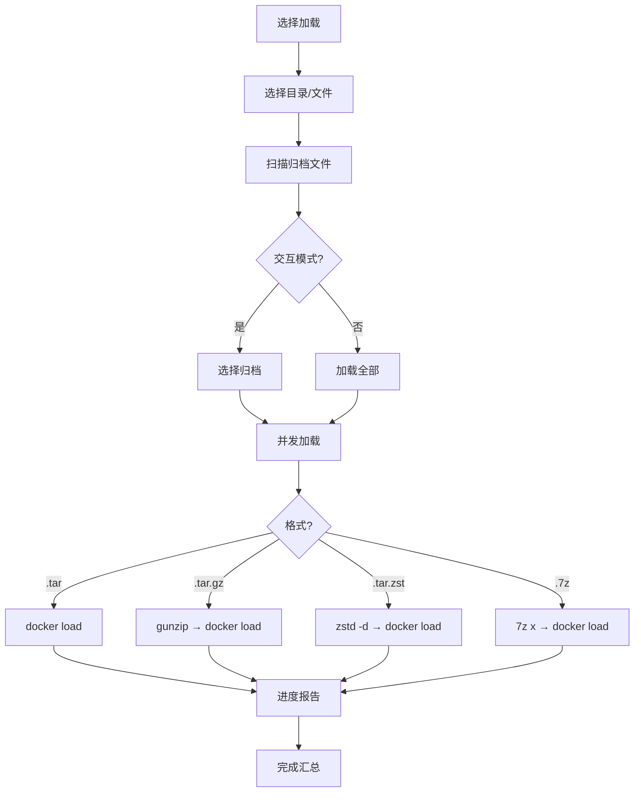
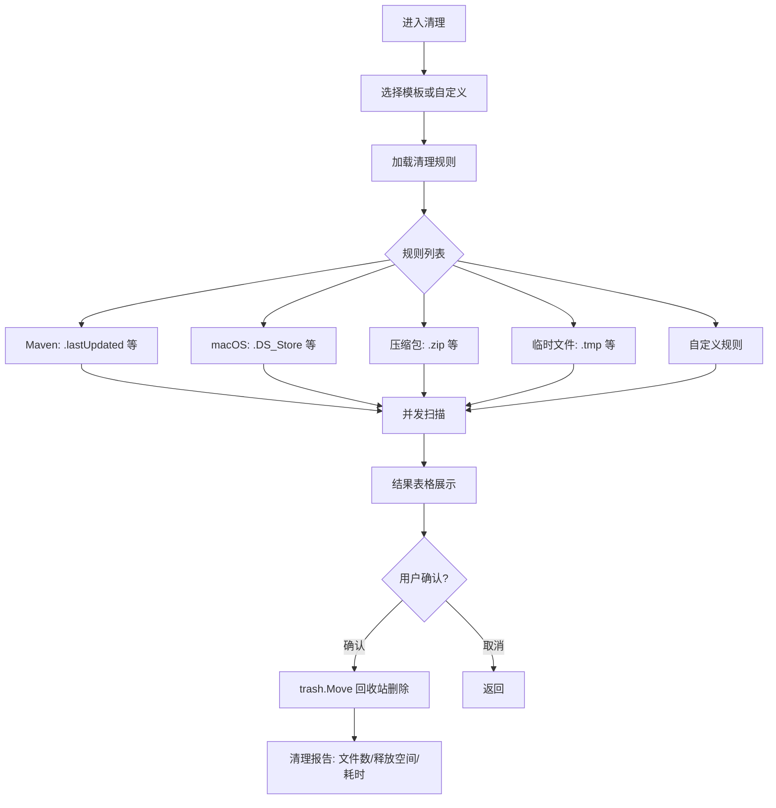
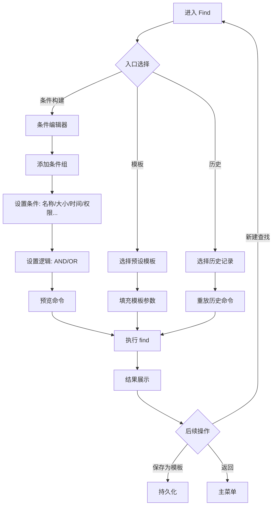
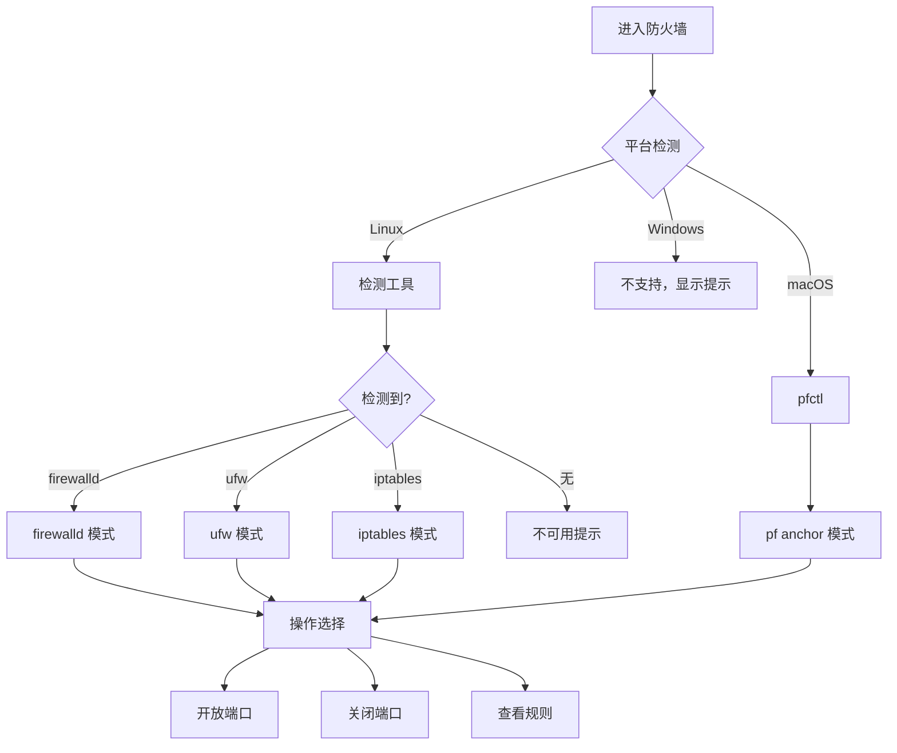
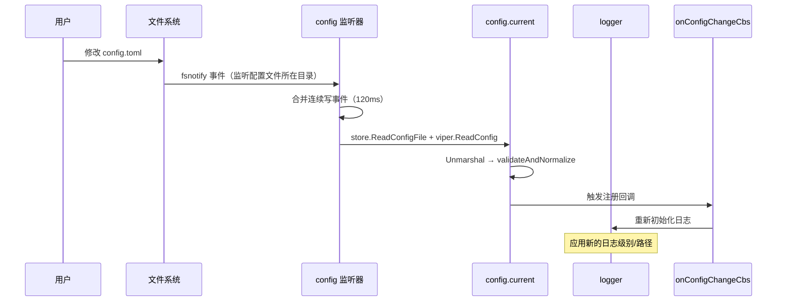
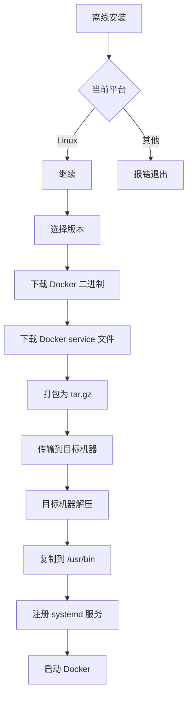
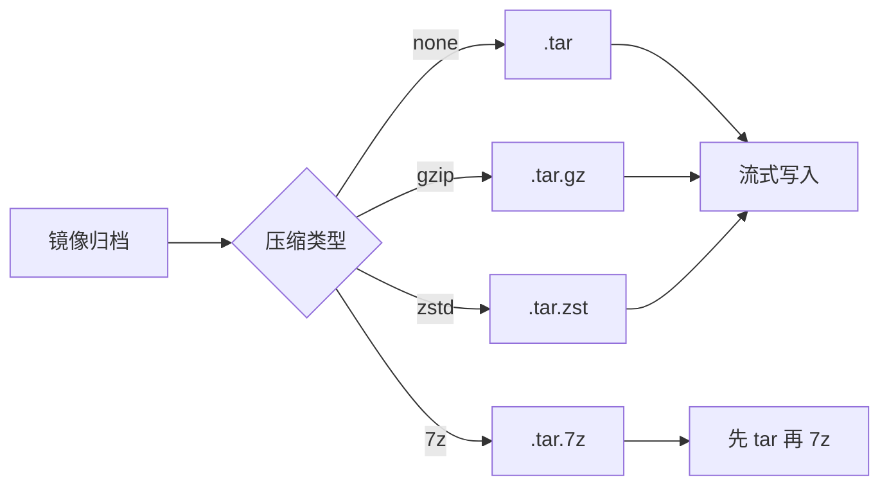

# 架构与流程

## 整体架构

```
┌─────────────────────────────────────────────────────────┐
│                     cmd/ru/main.go                       │
│                    CLI 入口 / TUI 入口                    │
└──────────┬──────────────────────────────────────┬────────┘
           │                                      │
    CLI 子命令                              TUI (bubbletea)
           │                                      │
┌──────────┼──────────────────────────────────────┼────────┐
│          │           internal/tui/               │        │
│  ┌───────┴──────────────────────────────────────┴──┐     │
│  │  MainLayoutModel (导航 + 面包屑 + 内容 + 帮助)     │     │
│  └──┬──────────┬──────────┬──────────┬────────────┘     │
│     │          │          │          │                    │
│  Docker    Clean       Find     Firewall               │
│  Controller Controller Model     Model                  │
└─────┼──────────┼──────────┼──────────┼──────────────────┘
      │          │          │          │
┌─────┼──────────┼──────────┼──────────┼──────────────────┐
│     │    应用服务层 (internal/app/)  │                   │
│     │          │          │          │                   │
│  ┌──┴──┐  ┌───┴───┐  ┌───┴───┐  ┌──┴───┐              │
│  │docker│  │clean  │  │ find  │  │fire  │              │
│  │ app  │  │ app   │  │ app   │  │wall  │              │
│  └──┬──┘  └───┬───┘  └───┬───┘  └──┬───┘              │
└─────┼─────────┼──────────┼──────────┼──────────────────┘
      │         │          │          │
┌─────┼─────────┼──────────┼──────────┼──────────────────┐
│     │    领域层 (internal/domain/)   │                   │
│  docker/   clean/      find/    firewall/               │
│  Entity    Entity      Entity   Entity                  │
│  Repository Repository Repository Repository            │
└─────┼─────────┼──────────┼──────────┼──────────────────┘
      │         │          │          │
┌─────┼─────────┼──────────┼──────────┼──────────────────┐
│     │    基础设施层 (internal/*)      │                   │
│  ┌──┴──┐  ┌──┴───┐  ┌──┴──┐  ┌──┴───┐  ┌──────┐      │
│  │docker│  │clean │  │find │  │fire- │  │config│      │
│  │ sdk  │  │rules │  │exec │  │wall  │  │logger│      │
│  └──────┘  └──────┘  └─────┘  └──────┘  │database│     │
│  ┌──────┐  ┌──────┐  ┌─────┐  ┌──────┐  │trash  │     │
│  │transfer│ │compress│ │fuzzy│ │platform│ │runner │     │
│  └──────┘  └──────┘  └─────┘  └──────┘  └──────┘      │
└─────────────────────────────────────────────────────────┘
```

## 程序启动流程



## TUI 导航流程



## Docker 镜像保存流程



## Docker 镜像加载流程



## 文件清理流程



## 文件查找流程



## 防火墙操作流程



## 配置热更新流程



监听器由 `internal/config` 自己用 fsnotify 管理，只监听一个配置文件、只占用一个 inotify 实例；同一份配置从相对路径和绝对路径重复加载时会复用同一个监听器。热更新是可选能力：inotify 实例或监听数量被宿主/其他容器耗尽时，`config.Load` 不会失败、更不会终止进程，只记录降级原因（`config.ConfigWatchError()`、错误回调与启动告警），本次运行跳过配置变更监听。不能用 `viper.WatchConfig` 承担这一步：它在监听器创建失败时会直接 `os.Exit(1)`，且默认丢弃日志，会让 `ru version` 这类一次性命令在受限环境里静默退出。

补充约定：配置路径在加载时统一转成绝对路径，因此相对 `--config` 下 `data_dir`、`cache_dir`、`logging.log_path` 的相对值以配置文件所在目录为基准，`ConfigFileUsed()` / `doctor` 展示的也是绝对路径；监听器只匹配配置文件本身的写入/新增事件，不解析符号链接目标，因此 k8s ConfigMap 这类“替换 symlink 目标”的更新不会触发热更新（需要重启或直接写回 `config.toml`）。

## Docker 离线安装流程



## 压缩策略选择


