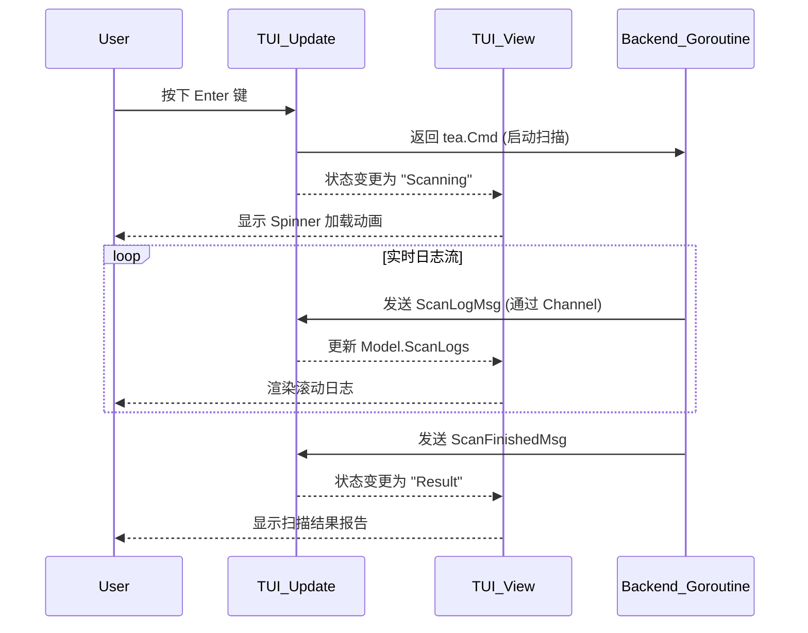
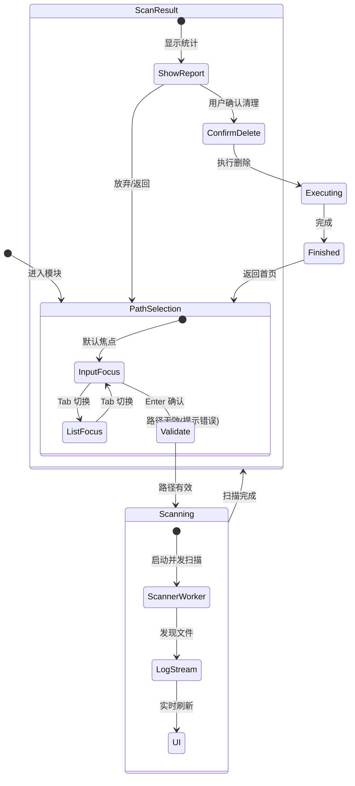

# 软件设计与用户文档

## 1. 软件概述

### 1.1 软件介绍
**软件名称**：utils-cli (内部代号 RUtil / dit)
**版本**：v1.0.0
**定位**：一款基于 Go 语言开发的高效、跨平台系统维护与运维 CLI 工具集。
**核心目标**：解决开发者与运维人员在日常工作中遇到的重复性、低效操作问题，提供统一、交互友好且功能强大的命令行解决方案。

### 1.2 项目背景
在日常开发与运维场景中，频繁涉及 Docker 镜像迁移、系统垃圾清理、文件查找以及防火墙配置等任务。传统的 Shell 脚本难以跨平台，且缺乏良好的交互体验与错误处理机制。utils-cli 旨在整合这些常用工具，通过现代化的 TUI (Terminal User Interface) 提升操作效率。

### 1.3 核心功能概览
*   **Clean (清理工具)**：智能扫描并清理 Maven 仓库失效文件、macOS 冗余文件、临时文件及自定义规则文件。
*   **Docker (容器管理)**：提供 Docker 镜像的批量导出、压缩、导入及清理功能，支持并发加速。
*   **Find (高级查找)**：基于条件的文件查找工具，支持历史记录回溯与快捷操作。
*   **Firewall (防火墙)**：屏蔽底层差异，提供统一的端口开放/关闭命令 (支持 UFW, iptables, PF)。

---

## 2. 系统架构设计

### 2.1 技术栈
*   **编程语言**：Go (Golang) 1.22+
*   **CLI 框架**：[Cobra](https://github.com/spf13/cobra) - 处理命令行参数解析与子命令路由。
*   **TUI 框架**：[Bubble Tea](https://github.com/charmbracelet/bubbletea) (基于 Elm 架构) - 构建交互式终端界面。
*   **样式库**：[Lipgloss](https://github.com/charmbracelet/lipgloss) - 负责终端 UI 的布局与美化。
*   **配置管理**：[Viper](https://github.com/spf13/viper) - 支持 TOML/YAML 配置文件加载与热更新。
*   **数据库**：[SQLite](https://github.com/glebarez/go-sqlite) - 本地轻量级数据存储（如查找历史）。

### 2.2 架构分层
系统采用清晰的分层架构设计，确保模块解耦与可维护性：

```mermaid
graph TD
    User[用户] --> Entry[入口层 (cmd/dit)]
    Entry --> Router{命令路由 (Cobra)}
    
    Router -->|CLI 模式| Controller[控制器层 (internal/*)]
    Router -->|交互模式| TUI[TUI 交互层 (internal/tui)]
    
    TUI -->|Msg/Cmd| Business[业务逻辑层]
    Controller --> Business
    
    Business -->|依赖注入| Infra[基础设施层]
    
    subgraph 基础设施层
        Config[配置中心 (Viper)]
        DB[SQLite 数据库]
        Logger[日志系统]
        Runner[并发任务池]
    end
```

### 2.3 UI 与后台交互架构 (MUV模式)
本项目 TUI 模块严格遵循 Model-Update-View (Elm 架构) 模式，实现 UI 渲染与业务逻辑的彻底分离。

#### 2.3.1 核心组件
*   **Model (状态)**：存储当前界面的所有状态数据（如输入框内容、列表选项、扫描进度）。
*   **View (视图)**：纯函数，根据 Model 渲染终端界面字符串。
*   **Update (逻辑)**：状态机核心，接收 Msg (消息) 并返回新的 Model 和 Cmd (副作用)。

#### 2.3.2 通信机制
1.  **Cmd (异步命令)**：当 UI 需要执行耗时操作（如文件扫描）时，Update 方法不直接执行，而是返回一个 `tea.Cmd`。该 Cmd 在后台 Goroutine 中执行，完成后通过 Msg 返回结果。
2.  **Msg (消息驱动)**：所有状态变更均由 Msg 触发，保证了状态流转的可追踪性。
3.  **Streaming (流式反馈)**：
    *   对于长时任务（如 Clean 模块的文件扫描），系统采用 **Channel + Recursive Cmd** 模式。
    *   后台扫描任务将日志写入 Channel。
    *   UI 层通过 `awaitScanLog` 递归命令不断从 Channel 读取日志并封装为 Msg 发送给 Update 循环，实现界面实时滚动更新而不阻塞主线程。



---

## 3. UI 设计与交互规范

### 3.1 设计理念
*   **Keyboard-first (键盘优先)**：所有操作均可通过键盘完成，支持 Tab 切换焦点、Enter 确认、Esc 返回等标准快捷键。
*   **Responsive (响应式)**：监听终端窗口大小变化 (`tea.WindowSizeMsg`)，动态调整列表高度与布局宽度，防止界面错位。
*   **Minimalist (极简主义)**：使用 Unicode 字符绘制边框与图标，配色采用柔和的 ANSI 颜色，减少视觉疲劳。

### 3.2 界面布局规范
*   **Header**：显示当前模块名称或面包屑导航。
*   **Content**：
    *   **List View**：左侧/居中显示选项列表，支持过滤与多选。
    *   **Detail View**：右侧或底部显示选中项的详细信息。
    *   **Input Field**：底部提供文本输入框，用于手动输入路径或查询条件。
*   **Footer**：状态栏，显示快捷键提示、当前进度或错误信息。

### 3.3 交互细节
*   **焦点管理 (Focus Management)**：
    *   在 `Clean` 模块中，使用 Tab 键在“路径输入框”与“规则列表”之间切换焦点。
    *   获焦组件边框高亮显示（如青色），失焦组件变暗（如灰色）。
*   **自适应边框**：
    *   使用 `lipgloss` 计算实际可用宽度 (`innerContentWidth`)，强制设置组件宽度，避免因内容过短导致边框坍缩。

---

## 4. 功能模块说明

### 4.1 Clean (清理模块)
*   **功能**：基于规则的文件清理。
*   **规则类型**：
    *   **Maven**: 扫描 `~/.m2/repository` 删除 `.lastUpdated` 文件。
    *   **macOS**: 删除 `.DS_Store`, `__MACOSX` 等。
    *   **Archive**: 删除 `.zip`, `.tar` 等压缩包（需确认）。
    *   **Generic**: 用户在配置文件定义的自定义规则（指定路径与后缀）。
*   **UI 特性**：
    *   支持手动输入路径或从预设列表选择。
    *   扫描过程中底部实时滚动显示发现的文件路径。
    *   扫描完成后展示统计报表（文件数/释放空间）。

### 4.2 Docker (容器管理模块)
*   **功能**：
    *   **Save**: 批量导出镜像，支持正则过滤、多线程并发、Gzip/Zstd 压缩。
    *   **Load**: 批量导入镜像，支持递归扫描目录、自动识别压缩格式。
    *   **Prune**: 清理 Exited 状态容器。
    *   **Service**: 为容器生成 Systemd 服务文件（Linux Only）。
*   **交互**：提供向导模式 (`wizard`) 引导用户逐步完成配置。

### 4.3 Find (查找模块)
*   **功能**：文件查找与定位。
*   **特性**：记录查找历史，支持快速重搜。
*   **存储**：使用 SQLite 记录查找关键词、路径与时间。

### 4.4 Firewall (防火墙模块)
*   **功能**：统一防火墙操作接口。
*   **后端适配**：
    *   Linux: 自动检测并调用 `ufw` 或 `iptables`。
    *   macOS: 调用 `pfctl`。
    *   Windows: (暂未实现或仅支持部分)

---

## 5. 业务流程图

### 5.1 Clean 模块工作流



---

## 6. 数据库设计

### 6.1 概览
项目使用 SQLite 作为嵌入式数据库，存储非易失性数据。默认文件路径：`./data/rutil.db` 或用户配置目录。

### 6.2 数据表结构

#### 表名：`find_history` (查找历史)
| 字段名 | 类型 | 约束 | 说明 |
| :--- | :--- | :--- | :--- |
| `id` | INTEGER | PK, AutoInc | 主键 ID |
| `command` | TEXT | NOT NULL | 执行的查找命令/关键词 |
| `path` | TEXT | NOT NULL | 查找的目标路径 |
| `result_count` | INTEGER | Default 0 | 查找到的文件数量 |
| `success` | INTEGER | Default 1 | 是否执行成功 (1/0) |
| `error_msg` | TEXT | Nullable | 错误信息（如有） |
| `created_at` | DATETIME | Default Now | 记录创建时间 |

---

## 7. 接口文档 (CLI Reference)

### 7.1 全局参数
*   `--config, -c`: 指定配置文件路径 (仅支持 .toml)。
*   `--debug`: 启用调试模式。

### 7.2 Clean 模块
命令：`dit clean [flags]`
*   `--rules`: 指定执行的规则 ID (如 `maven,temp`)，逗号分隔。
*   `--dry-run`: 仅模拟扫描，不执行物理删除。

### 7.3 Docker 模块
#### List (列出镜像)
命令：`dit list [flags]`
*   `--filter`: 按 `repo:tag` 正则过滤。
*   `--json`: 输出 JSON 格式。
*   `--interactive, -i`: 交互式选择模式。

#### Save (保存镜像)
命令：`dit save [flags]`
*   `--all`: 保存所有镜像。
*   `--filter`: 正则筛选保存。
*   `--compress`: 压缩算法 (`gzip`, `zstd`, `none`)。
*   `--concurrency`: 并发线程数。
*   `--output`: 输出目录。
*   `--interactive, -i`: 交互式向导模式。

#### Load (加载镜像)
命令：`dit load [flags]`
*   `--input`: 输入目录或文件路径。
*   `--recurse`: 是否递归扫描子目录 (默认 true)。

### 7.4 Firewall 模块
命令：`dit firewall [open|close|list] [flags]`
*   `-p`: 指定端口 (如 `8080`, `80,443`)。

---

## 8. 非功能性需求

### 8.1 性能要求
*   **并发扫描**：Clean 模块需支持多线程文件扫描，在 SSD 上扫描速度应达到系统 IO 瓶颈。
*   **低内存占用**：大文件处理（如 Docker 导出）应使用流式 IO，避免将整个文件加载进内存。

### 8.2 兼容性
*   **OS 支持**：
    *   Windows 10/11 (PowerShell/CMD)
    *   macOS (Intel/Apple Silicon)
    *   Linux (Ubuntu/CentOS 等主流发行版)
*   **终端支持**：支持 ANSI 颜色转义序列的标准终端（xterm-256color）。

### 8.3 可扩展性
*   **规则引擎**：Clean 模块需支持通过配置文件 (`dit.yaml`) 动态添加新的清理规则，无需修改代码。

---

## 9. 部署与运维指南

### 9.1 环境要求
*   **操作系统**：Windows / Linux / macOS
*   **运行时依赖**：
    *   Docker (仅 Docker 模块需要)
    *   7z (可选，用于解压特定格式)

### 9.2 编译与构建
项目提供了自动化构建脚本：

**Windows**:
```powershell
./scripts/build.ps1
```

**Linux/macOS**:
```bash
make build
# 或
./scripts/build.sh
```
构建产物将位于 `bin/` 目录下。

### 9.3 故障排查
*   **日志文件**：默认日志位于 `./logs/app.log`。
*   **调试模式**：运行命令时添加 `--debug` 参数，可输出详细堆栈信息和调试日志。

---

## 10. 项目文档索引

*   [架构设计文档 (Architecture)](docs/architecture.md)
*   [配置说明书 (Configuration)](docs/configuration.md)
*   [平台兼容性说明 (Platform Support)](docs/platform-support.md)
*   [查找模块设计 (Find Design)](docs/find-module-design.md)

