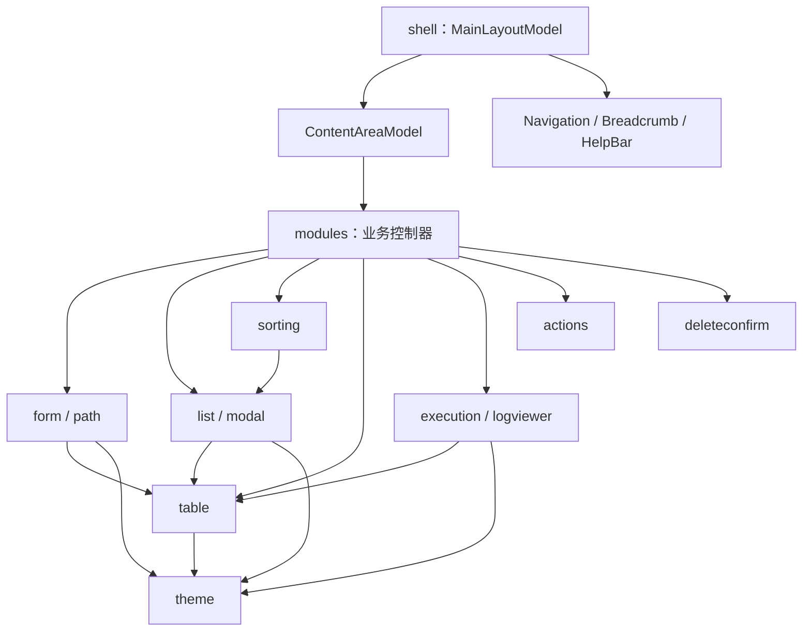

# TUI 公共组件开发基线

> 本文档是 utils-cli TUI 公共能力的开发基线。新增或改造 TUI 功能时，先按本文选择组件与接入链路，再阅读对应源码和测试。强制规则仍以 AGENTS.md 与 internal/tui/components/README.md 为准；若文档与当前代码或测试冲突，应立即修正文档或实现，不能在业务模块复制例外实现。

公共结构化表格使用 C 布局：公共边框标题、列间竖线和表头下横线，保持原有配色；列表搜索仅按 `/` 展开，F4 命令面板搜索常显。接入和回归规则见 [组件清单](../internal/tui/components/README.md#结构化表格) 与 [搜索契约](tui-search-path-history.md)。

## 1. 范围与信息入口

本基线固化以下内容：

1. 公共组件的职责、结构和依赖边界；
2. 可被模块调用的主要公开类型、构造函数、关键方法和返回约定；
3. Shell、模块与组件间的焦点、按键、面包屑、弹框和异步任务联动；
4. 新能力的组合配方、测试边界与验收清单。

| 文档 | 用途 |
| --- | --- |
| internal/tui/components/README.md | 强制接入规则和最小验证要求。 |
| internal/tui/shell/README.md | 应用壳职责说明。 |
| docs/neumorphic-modal-api-inventory-2026-07-24.md | 内容拟态弹框专项接口说明。 |
| docs/tui-public-component-migration-tasks.md | 历史迁移任务，不作为当前 API 依据。 |

## 2. 分层、目录与依赖方向

~~~text
internal/tui/
├── components/                 # 跨模块通用交互与渲染
│   ├── actions/                # 生成物后续动作
│   ├── deleteconfirm/          # 连续两下 d 删除待确认
│   ├── execution/              # 执行信息、日志、进度、状态徽章
│   ├── form/                   # 参数表单、编辑器、非路径建议
│   ├── list/                   # 紧凑菜单、编号、多选、弹框、叠加层
│   ├── logviewer/              # 只读日志查看器
│   ├── path/                   # 路径编辑、建议、补全、展示
│   ├── sorting/                # 列表多列排序、类型化比较、排序弹框
│   ├── table/                  # 自适应结构化表格
│   └── theme/                  # 样式与工作台尺寸常量
├── modules/<module>/           # 业务状态机、服务调用、薄适配
├── shell/                      # 模块注册、布局、焦点、帮助栏、面包屑
└── unified/model.go            # 迁移期共享页面模型
~~~

依赖必须单向向下：shell → modules → components。组件只能依赖更底层的公共组件，不能依赖 Docker、数据库等业务模块或 Shell；unified 是已有页面的兼容入口，不能成为新公共能力的默认落点。

| 层 | 必须负责 | 不得负责 |
| --- | --- | --- |
| components | 通用模型、渲染、尺寸收敛、局部交互和校验。 | 模块状态、业务条件、服务调用。 |
| modules | 业务状态机、服务调用、字段值、把组件返回值映射为状态变化。 | 手写通用表格、弹框、菜单、路径补全、执行视图。 |
| shell | 模块注册、工作台尺寸、导航/内容焦点、全局路由、帮助栏与面包屑。 | 模块私有的编辑、确认、执行分支。 |
| unified | 既有模块的列表/详情/日志/进度页面兼容。 | 新的通用表单、弹框、表格或 Shell 行为。 |

## 3. 与 Shell 和布局层的边界

公共组件不保存终端总尺寸，也不管理模块注册、导航焦点、帮助栏、面包屑或跨模块服务。模块只将 Shell 下发的内容区宽高传给组件；布局公式、窗口最小值、事件/焦点路由、表单列宽、弹框与执行视图尺寸规则统一见 [TUI Shell 与布局开发基线](tui-shell-layout-development-baseline.md)。

组件 API 使用的通用参数约定如下：

| 参数或返回值 | 契约 |
| --- | --- |
| width, height | 父容器可用尺寸，不是终端全局尺寸；组件自行收敛到最小值。 |
| columns, rows | 结构与原始数据；列宽与截断由 table 处理。 |
| selectedIndex | 当前可见列表或字段的零基索引；条件字段基于 VisibleParameterFormFields。 |
| items | Bubble list.Item 列表；标题、描述、编号由接口提供。 |
| tea.Msg / tea.KeyPressMsg | Shell 决定路由，模块决定业务状态，组件处理局部交互；分发只处理按键按下消息，不使用会匹配按键释放的 `tea.KeyMsg` 接口。 |
| tea.Cmd | 模块返回 Shell 的延迟或异步结果；View 期间不可执行。 |
| confirmed, closed | 弹框确认与关闭不同：确认提交选择，关闭只恢复来源状态。 |
| ActionLoadOlder / ActionClose | 日志查看器请求模块加载历史或退出查看，不访问日志源。 |

## 4. 公共组件 API 与调用边界

### 4.1 components/table：所有结构化数据的默认出口

源码：internal/tui/components/table/table.go；测试：table_test.go。

| API | 职责 |
| --- | --- |
| TableColumn | 列契约：Title、Width、MinWidth、MaxWidth、Flex、FlexWeight、DisplayPriority、HideBelow、Align、Placeholder、TimeCompact、Wrap、Fixed。 |
| TableAlignLeft/Right/Center | 文本、数值、状态等单元格对齐。 |
| RenderTableBlock | 输出标题、表头、分隔线和数据行；无行时输出暂无数据。 |
| RenderSelectableTableBlock | 输出带当前选中行样式的只读表格；调用方只提供当前行下标，不得在业务模块手写选中行颜色。 |
| FitTableColumnsWithRows | 先按 HideBelow 过滤固定断点列，再按每列最长内容计算宽度（标题是下限、MaxWidth 是上限）；内容放不下时按 DisplayPriority 从 Optional 到 Primary 收缩，仍放不下的列在列内自动换行且最多两行，余量只补给内容仍未完整显示的列。RenderTableBlock、RenderSelectableTableBlock 内部使用它。 |
| FitTableColumns | 只按列契约和可用宽度分配，用于拿不到数据行的固定布局（例如参数表单编辑器列宽）；带数据行的表格必须用 FitTableColumnsWithRows。 |
| TableColumnContentWidths、LimitTableCellLines、TableColumn.MaxLines、DefaultWrapMaxLines | 内容宽度测量、换行行数上限与显式覆盖；显式 Wrap 的详情列用 MaxLines 0 保持完整不省略。 |
| RenderTableHeader、RenderTableRow、TableColumnValue、VisibleColumnSourceIndex、VisibleColumnIndex | 渲染表头/行；复杂块自定义渲染时按原始列索引读取值，避免中间列隐藏后错位。 |
| NewHorizontalTableLayout、HorizontalTableLayout | 第三种表格展示模式：至少一个 `Fixed` 左侧固定列，固定列与非固定列均按原始完整值计算宽度，极窄终端才收缩固定区；两区之间统一绘制不嵌套 ANSI 的细虚线 `┊`，非固定列通过 `Scroll` / `Offset` 横向访问；`RenderHeader` 与 `RenderRow` 必须使用同一布局实例。 |
| TruncateTableCell、AlignTableCell、CompactTableTime、TableWidth | 给表单、执行视图等复用，模块不得重新实现。 |

每列都要填 Width 和 MinWidth。公共表格按每列最长内容计算列宽，内容完整时不再平均撑宽，列表、摘要、监控中的长路径、ID、镜像名因此不会把短列挤出大片空白；内容超过可用宽度时按 `DisplayPriority` 从 `Optional` 到 `Primary` 依次收缩（低价值列用 `Optional`），仍放不下的列在列内自动换行并限制为两行，列表 delegate 必须按实际最大行高设置 `Height()`。固定断点用 `HideBelow`；新增代码禁止使用兼容字段 `HidePriority`。`FitTableColumns` 会保留每列原始索引，因此调用方始终传完整原始数据行；自定义行渲染必须用 `TableColumnValue` 或 `VisibleColumnSourceIndex` 获取数据。完整详情、详情弹框和只读配置页必须对需要完整展示的列设置 `Wrap: true`，字段名与字段值窄屏时换行而不使用省略号。需要单行访问长字段时使用横向模式：固定列必须显式声明 `Fixed: true` 且至少一列；正常宽度下固定与右侧字段均完整显示，极窄终端才收缩固定区，二者由不嵌套 ANSI 的细虚线 `┊` 分隔；右侧字段不截断、不换行，模块通过已注册的 `←/→` 更新布局偏移；表头和数据行必须复用同一 `HorizontalTableLayout`。单对象详情同样用属性/值表格。日志、命令原文、堆栈才可以是纯文本。

### 4.2 components/list：菜单、编号、多选、弹框与覆盖层

源码：internal/tui/components/list/compact_delegate.go、modal_list.go、overlay.go；测试：compact_delegate_test.go、modal_list_test.go。

| API | 职责与调用方式 |
| --- | --- |
| IndexedItem | 可选 ItemIndex() string，让菜单和弹框显示统一编号。 |
| SubmenuListConfig、DefaultSubmenuListConfig | 配置颜色、选中前缀、描述分隔符、补零和多选标记。 |
| NewMenuDelegate、NewConfiguredMenuDelegate | 供实现 Title/Description/FilterValue 的菜单项使用。 |
| NewCompactDelegate、NewConfiguredCompactDelegate | 适配非标准标题项。 |
| NewFocusedMenuDelegate、WithFocus | 把 controller.HasFocus 传给 delegate。默认焦点为 false，失焦必须灰色。 |
| RenderSubmenuListItem、RenderSubmenuSelectionMarker | 公共行和多选标记；业务层不可手写勾选符号。 |
| NumberSelectionBuffer | 多位编号缓冲；Select 只定位，PendingLine 给 Shell 显示。 |
| WrapListCursor、MoveListCursorByMouseWheelWithGate、NewMouseWheelGate | 上下键和滚轮循环定位；每个被接受的滚轮消息移动一项，密集重复事件消费但不跳项；筛选态不拦截。 |
| LocalizeListKeyMap、SetupListForFind | Bubble list 中文键位和 Find 场景配置。 |
| NewModalListModel | 选择型弹框。 |
| NewLoadingModal | 异步读取列表、详情或只读配置时覆盖最终目标页面的等待层；不能以通用执行页作为短暂中间页。 |
| NewContentModal | 保留来源页的只读详情、确认或短任务弹框。 |
| SetSize、SetItems、Items、SetLoading、SetMessage | 响应尺寸变化或异步返回。 |
| CursorItem、Filtering | 读取光标所在候选项，以及弹框是否正在接收搜索输入；需要在候选项上展开二次状态（排序方向）或让出搜索态按键时使用，不得自行推算可见行下标。 |
| SetMultiSelect、SelectedItems、SelectTitles | 开启多选、读取选择、回显既有选择。 |
| ToggleSelectAll | 多选弹框的一键全选/取消全选：当前可见项全部已勾选时清空全部勾选，否则勾选全部可见项（筛选生效时只作用于筛选结果）；返回勾选是否变化。调用方必须在帮助栏声明 `r a` 后再消费。 |
| SetTitle、SetContent、SetFooter | 刷新内容弹框；SetContent 回到首行。 |
| SetToggleClose、ToggleClose | 登记/读取覆盖层的开关键与帮助说明：覆盖层显示期间再按该键关闭（等价 Esc/q），Shell 据此自动在帮助栏追加 `<键> 关闭…`；搜索输入态下可打印字符仍作为查询内容。排序弹框通过 `sorting.Picker.SetToggleClose` 转发。 |
| SetModalPlacement、SetDropdownAnchor、FocusTitle | 普通弹框贴底；表单单选通过公共表单设置字段锚点，当前值定位及异步候选回填由公共列表负责。 |
| Update(tea.KeyPressMsg) | 返回 item、confirmed、closed；业务层据此更新字段、提交或销毁弹框。 |
| UpdateMouse(tea.MouseMsg) | 内容弹框优先调用；true 表示已消费，背景不能再处理。 |
| View(background, width, height) | 覆盖来源页面；业务通常不直接调用低层 overlay。 |
| PlaceOverlay 系列、CenterOverlay 系列 | 低层工具，仅组件内部或确有通用需求时使用。 |

列表项必须实现 Bubble list.Item；默认菜单 delegate 还要求 Title/Description。数字键永远不直接执行，超过 9 项连续输入定位，Enter 才确认。弹框多选中 Space 切换，未选任何项时 Enter 先选当前项再确认；一键全选/取消全选走 `ToggleSelectAll()`，由调用方在帮助栏声明 `r a`。

内容弹框支持 ↑↓/k/j 行滚动、PgUp/PgDn 翻页、Alt+↑/Alt+↓ 按 RenderTableBlock 标题块跳转。滚轮每次 3 行；所有鼠标事件都要先被弹框消费，左键不关闭以保留终端文本复制；关闭后回到来源页面、来源光标和来源状态。

由单个按键打开的只读展示层一律是开关：模块在打开覆盖层的入口调用 `SetToggleClose(开关键, 帮助说明)`（排序弹框用 `sorting.Picker.SetToggleClose`），公共弹框在 `Update` 最前面识别该键并返回 `closed=true`，帮助栏由 Shell 的 `appendOverlayToggleHelp` 自动派生，模块不得在每个弹框态重复声明关闭键。该能力覆盖内容弹框、列表型明细弹框、排序弹框和 F4 功能搜索；普通阻塞任务的加载弹框不登记开关键。关闭后必须回到来源页面，来源状态、光标、勾选和滚动保持不变。

### 4.3 components/form：参数表单、编辑器、非路径建议

源码：internal/tui/components/form/parameter_form.go、inline_editor.go、input_suggest.go；测试为同名 _test.go。

| API | 职责 |
| --- | --- |
| ParameterFormField | 字段模型：标识、标签、原始值、类型、输入/路径校验、范围、业务校验器、说明、条件显示、编辑和校验状态。 |
| ParameterFormKind 系列、SupportedParameterFormKinds | 公共中文类型枚举；新字段使用常量，不建私有标签。 |
| ParameterFormInputType、DefaultParameterFormInputType | 文本、数字、路径、密码、主机和主机/端口输入限制。 |
| ParameterFormPathValidation | exists/file/directory/none；远程路径和待生成输出显式设为 none。 |
| ParameterFormFieldValidator | 业务追加校验的唯一接口。 |
| VisibleParameterFormFields、IsVisible | 同时驱动渲染、导航、动作分发和校验。 |
| RenderParameterForm、RenderParameterFormWithAction | 只读表单与带高亮操作按钮的二次确认页；字段名、值和类型在列内换行，完整保留长路径等确认内容。 |
| ConfirmationModel | 长只读确认页固定表头及按钮，完整正文按行、翻页、首尾和滚轮浏览；调用方注册滚动键并处理确认。 |
| ConfigureParameterFormLayoutDropdown | 与单区块长表单共用字段窗口计算下拉锚点。 |
| NewParameterFormButton | 参数页整体确认、保存或执行行，复用字段导航和公共按钮类型，不进入文本编辑。 |
| NewParameterFormTestButton、NewParameterFormTestAndSaveButton、NewParameterFormTestAndContinueButton、IsParameterFormActionButton | 需要先验证再保存的参数页把“只测试”和“测试并保存/测试并继续”拆成两行操作，按钮行在上、保存或继续行在下，按字段 ID 分派；落盘用 Save、只进入确认页用 Continue；IsParameterFormActionButton 区分动作行与字段行。 |
| ParameterFormLayoutOptions.ActionNotice | 把测试/保存结果的公共提示框贴在表单中下部，并优先占用贴底高度；失败时显示具体错误并留在当前表单，只测试成功不落盘、不跳转。 |
| RenderParameterFormFields、RenderParameterFormFieldsLayout、RenderParameterFormFieldsPinned | 普通字段页、贴底说明与集中校验摘要；表单标题嵌入上边框，不另占内容行；单区块长表单用 Height 与 ScrollFields 保留焦点字段及操作按钮。 |
| RenderParameterFormSectionsScroll、ParameterFormScrollRender | 多区块长表单的整页滚动模式：不读取 Height、不删除任何字段，返回完整 Content、贴底 Footer（动作结果 > 校验汇总 > 字段说明）与当前字段 FocusLine；模块把 Content/Footer/FocusLine 交给 UnifiedPageModel 的 SetDetailContentWithFocus / SetDetailFooter，由公共页面做焦点跟随和贴底说明，动作行随内容滚动。 |
| ValidateParameterFormField 系列、FirstInvalidParameterFormFieldIndex | 必填、数字、路径、文件、主机、主机/端口和业务校验。 |
| RenderParameterFormValidationSummary | 公共底部错误框（字段级校验）。非字段级的验证失败使用 notice.RenderErrorDetailWithFocus 作为 ActionNotice。 |
| notice.RenderSuccessWithFocus、notice.RenderErrorDetailWithFocus | 表单中下部的成功结论与完整错误详情；详情框按显示宽度换行，不省略具体错误。 |
| ParameterFormOption、NewParameterFormSelect | 固定候选下拉；Value 与 Label 分离，只在确认后提交。 |
| ConfigureParameterFormDropdown、ConfigureParameterFormSectionsDropdown | 动态候选与多区块表单的值列锚点，自动适应窗口宽度。 |
| ParameterFormWidth、SubpageWidth、SubpageContentWidth、NoticeWidth、EditorWidth、ValueWidth、ValueOffset | 表格、边框、贴底动作提示框和编辑器的同一套宽度计算；ActionNotice 必须用 NoticeWidth 渲染才能与表单框对齐。 |
| NewInlineEditor、Start、SetInputType、Update、View | 唯一的内联编辑器入口，使用下划线光标。 |
| FilterInputSuggestions、MoveInputSuggestionSelection、SelectedInputSuggestion、RenderInputSuggestionsBox | 主机、端口、用户名等非敏感输入的内联建议。 |

Value 必须始终是原始输入。初始空表单的 Required 字段只在最前方固定一格、左对齐的状态列显示红色 `*`，紧贴字段列且不改变字段和值列布局，也不得默认显示错误行或底部警告框；当前选中或编辑时由黄色 `>` 独占该列。已有值的格式错误或提交校验失败后，才通过 Invalid 和公共摘要呈现错误。编辑时用 Editing: true 和 EditorView，编辑状态优先于任何已有错误样式，绝不能把带 ANSI 光标的 editor.View 写回 Value。字段条件改变后，模块必须先重新取得 VisibleParameterFormFields 再索引、导航和保存。单选枚举（`选择`、`枚举`、`选择/输入`）必须展开公共下拉，禁止直接循环改值；开关保留切换，多选保留公共多选列表；密码和令牌不得进入建议源或建议框。

### 4.4 components/sorting：列表多列排序

源码：internal/tui/components/sorting/sorting.go、picker.go；测试：sorting_test.go、picker_test.go。

列表需要按列排序时，禁止在业务模块里写 `sort.Slice` 和字符串比较，必须复用本组件。

| API | 职责 |
| --- | --- |
| Field | 可排序字段声明：Title、Column（原始数据行下标，不是可见列下标）、Kind（比较类型）。 |
| Kind 系列 | 字符串到比较键的转换方式：KindText 拼音文本、KindNatural 自然序、KindNumber 数值、KindBytes 容量、KindCount 带单位计数、KindRelativeTime 相对时间、KindBool 是否、KindAuto 自动识别。 |
| Rule、Order | 排序键与方向；Order 是有序列表，前一个键优先级更高，每个键的方向独立。 |
| Order.Marker | 返回表头方向标记（` ↑`、` ↓`，多键时带优先级数字），未参与排序返回空串。 |
| Permutation | 按 Order 返回稳定的原始行下标序列；相等时保持原顺序。 |
| Reorder | 按 Permutation 重排条目副本，调用方不得自行重排行文案。 |
| Compare | 按 Kind 比较两个原始文案，供单测和少量直接比较使用。 |
| NewPicker、Picker.Modal、Picker.Update、Picker.UpdateMouse、Picker.Order | 排序字段弹框：Space 加入/移出、←→ 切换升降序（未参与时直接加入）、Shift+↑/↓ 上移/下移优先级（已在首尾或未参与时保持不变）、Enter 应用、Esc/q 取消并回到打开时的排序；鼠标事件必须转交它完全消费。 |

使用规则：`Kind` 必须显式声明，不能靠自动猜测，否则“多个”“未知”这类占位文案会得到难以解释的顺序；容量列用 `KindBytes`、`"2 个"` 用 `KindCount`、`"3 个月前"` 用 `KindRelativeTime`，字符串比较会得到 `10MB < 9MB` 这类错误结果。中文文本按拼音比较，数字段按数值比较。无法解析的值始终排在可比较值之后，与升降序无关。排序只改变显示顺序和显示位置，不得改变按行 id 记录的勾选状态或提交集合；重排后由调用方按显示位置重编“序号”列。公共列表按条目顺序的哈希保存光标，重排会让光标退回第一行，因此默认重建列表后按行 id 把光标复位到原行。Docker 主镜像列表确认排序时保留原可见行下标，避免光标和页码追随原镜像跳动；数据刷新和标签勾选仍按行 id 保留当前项，详见 [镜像列表契约](tui-command-navigation.md)。表头方向标记必须在计算列宽之前追加，表头和数据行必须使用同一份列定义（含标记），否则箭头会让列错位。

排序弹框可以覆盖在来源弹框（只读详情、多选列表）之上：覆盖期间它优先接管 `GetModal`、键盘和鼠标，确认或取消后回到来源弹框并保留来源弹框的光标、滚动与勾选，弹框内的表格排序还必须每次渲染都读当前排序键。

重建列表（排序、勾选刷新、数据刷新）不得清掉用户正在使用的筛选：`SetListItems` 会重置筛选，必须在重建前记住 `ListFilterValue()`、重建后立刻用 `SetListFilter` 放回去，并按 `VisibleListItems()` 的可见下标恢复光标。

Picker 基于公共 `ModalListModel`，不写死 `[ ]`/`[x]`；光标所在项通过 `ModalListModel.CursorItem` 读取，搜索输入态通过 `Filtering()` 判断并让出字母键。优先级既可以用 `Space` 移出后按新顺序重新加入，也可以直接用 `Shift+↑/↓` 与相邻排序键交换，调整后每一行的“第 N 优先”与表头优先级标记必须同步刷新。弹框状态必须在帮助栏声明 `Space`、`←→`、`Shift+↑↓`、`Enter`、`Esc/q` 和上下移动，弹框打开时不得继续声明来源页动作键。

### 4.5 components/input：局部输入优先级

源码：internal/tui/components/input/router.go；测试：router_test.go。

`input.Registry` 管理同一页面或模块内的局部 `Receiver`。每个接收者必须声明稳定 `ID`、`Priority` 与 `Handle`；注册后默认关闭，调用 `Enable` 才会参与调度，`Disable` 和 `Unregister` 用于停止接收。状态相关的接收权必须用 `Active` 表达，具体按键入口与接收范围必须用 `Matches` 表达，不能通过业务状态机的分支顺序抢输入。用户可主动触发的输入快捷键必须通过 `Shortcut` 注册，shell 会自动显示到帮助栏。列表筛选必须由同一接收者同时注册 `/` 触发键及进入筛选后的后续字符。

`Dispatch` 每次只调用一个已启用、激活且匹配当前按键的最高优先级接收者；同一注册表不得注册重复优先级，出现冲突时 `Register` 返回错误。默认层级为 `PriorityListFilter`、`PriorityInlineEditor`、`PriorityModal`。模块需要让 shell 在状态机前先分发输入时，实现 `shell.InputReceiverProvider`；弹框覆盖层与 `Ctrl+C` 仍由 shell 保持更高层级。

编辑态必须用 `input.IsTextKey` 同时接收 `tea.KeyPressMsg` 的文本按键与 `tea.PasteMsg`；粘贴内容只作为文本插入、不得再解析成快捷键，文本先于 Shell 的 `q` 返回、编号与 `j/k` 导航；控制键仍以帮助栏授权。Bubble Tea v2 下分发只处理 `tea.KeyPressMsg`，`tea.KeyMsg` 接口会同时匹配按键释放事件，不得再用作状态机 case。统一输入页内置文本接收者使用 `PriorityDefault`，模块自管编辑器使用更高且唯一的优先级，弹框可见时来源页接收者必须停用。编辑器的值在确认前只作为草稿，取消不得修改原值或退出整个来源流程。

回归测试必须从 `MainLayoutModel.Update` 逐键分发，覆盖字符 `q/j/k`、独立空格、左右/首尾光标、退格/Delete、未声明控制键无效和确认/取消。数据库导入、导出、备份，Clean 模板与路径，Find 自定义、模板和条件编辑，Docker 表单与追加草稿、防火墙多端口输入均须覆盖对应状态。只测试模块自己的 Update 无法证明 Shell 没有提前拦截。

### 4.6 components/path：本地路径体验

源码：internal/tui/components/path/path_suggest.go；测试：path_suggest_test.go。

| API | 职责 |
| --- | --- |
| StartEmptyPathInput | 用空值、宽度和建议模式初始化 InlineEditor。 |
| UpdatePathInputSuggestions、RefreshPathInputSuggestions | 更新编辑器并刷新目录候选。 |
| CompletePathInput | 单候选直接补全，多候选补公共前缀。 |
| ResolveEmptyPathToCWD | 空输入提交时解析当前目录。 |
| DisplayPath、DisplayPathWithCWD、DisplayPathInputWithResolved、CompactPath | 当前目录标识、原始/解析路径展示和可靠省略。 |
| PathSuggestions、VisiblePathSuggestions | 按输入前缀获取本地目录候选。 |
| MovePathSuggestionSelection、SelectedPathSuggestion、PathSuggestionWindowStart | 循环选择与候选窗口定位。 |
| RenderPathSuggestions 系列 | 统一建议框与截断布局。 |

本组件只处理本地文件系统。空输入显示并保存为当前目录；远程路径仍可用表单字段，但必须关闭本地路径校验。模块不得自行用 filepath.Clean 重做展示或补全。

### 4.7 components/execution：异步任务、日志、进度和状态

源码：internal/tui/components/execution/task_execution.go、status_theme.go；测试：同名 _test.go。

| API | 职责 |
| --- | --- |
| NewTaskExecutionModel(columns, rows, statusIndex, logs) | 完整执行视图；运行态自动进入不定量进度。 |
| NewSimpleTaskExecutionModel | 单任务简化构造。 |
| TaskExecutionModel.Render、ExecutionPanelHeights | 上半结构化执行信息、下半可滚动日志。 |
| AppendLog | 添加阶段、命令、错误和最终日志；同步写入 ru.log，最多保留 200 行。 |
| SetStatus、SetCell、AppendRows | 更新任务行和动态子任务。 |
| SetProgress、SetIndeterminateProgress、CompleteProgress、ClearProgress | 确定量百分比、不定量总量未知、完成和清除。 |
| CompletePendingRows、MarkAllFailed | 收敛任务状态。 |
| SetHeader、SetResult、SetCompletionBehavior、ShouldReturnToSource、HandleCompletionKey | 预检与最终结果留在同一执行视图；完成后默认返回来源菜单，生成物或需要保留结果时显式保持可见。 |
| ToggleFocus、HandleScrollKey、LogYOffset、TaskYOffset | 切换并滚动执行信息和日志区。 |
| StatusKind、ClassifyStatus、ThemeForStatus、RenderBadge、DominantStatus | 集中映射中文状态到自适应颜色徽章。 |

会产生执行日志、进度、文件系统变更或可恢复结果的实际操作，一进入异步状态就立即创建执行视图。可靠总量才调用 SetProgress；未知总量调用 SetIndeterminateProgress，亮块只表示仍在运行，不能伪造完成比例。仅用于读取最终列表、详情、只读配置或报告的查询，必须先建立目标页面并以 `NewLoadingModal` 覆盖，不能短暂切换通用执行页；加载期间模态框必须隔离按键和鼠标，结果或错误返回后立即关闭。完成调用 SetResult / CompleteProgress；失败追加原因并标记失败。执行结果和日志的长文本按当前宽度换行，完整错误通过任务区或日志区滚动访问，不得截断。模块不得直接打印终端或额外写重复日志。

### 4.8 components/logviewer：实时与历史只读日志

源码：internal/tui/components/logviewer/log_viewer.go；测试：log_viewer_test.go。

| API | 职责 |
| --- | --- |
| New(title) | 创建查看模型。 |
| SetLines(lines) | 接收受限完整快照，归一化换行并重渲染。 |
| FilterQuery | 读取筛选关键词。 |
| Update(tea.Msg) Action | 处理滚动、筛选、跟随、换行；返回 ActionLoadOlder 等动作。 |
| Render(width, height) | 输出查看器正文与状态。 |

模块负责轮询、重连、去重、内存上限和历史 API。只有当前状态帮助栏已注册时，才把 /、f、w、滚动和关闭键交给查看器；ActionLoadOlder 由模块加载更早内容。原始日志可纯文本，来源/时间/资源元信息必须表格化。

### 4.9 components/actions：生成物后续动作

源码：internal/tui/components/actions/generated_actions.go；测试：generated_actions_test.go。

| API | 职责 |
| --- | --- |
| GeneratedArtifact | Label、Path、Kind；Kind 为 dir 表示目录。 |
| NewGeneratedActions、Empty | 过滤无效路径并构造动作集合。 |
| ActionHelps | 提供底部帮助项：目录 o/O，文件额外 `r o/r O`。 |
| HandleKey | 返回 tea.Cmd，最终产生 GeneratedActionResultMsg。 |
| OpenPath | 依平台使用 open、rundll32 或 xdg-open。 |
| OpenPathSupported、OpenSupportedFunc | 按环境门控打开动作；无图形桌面或远程会话时隐藏帮助项并忽略按键。 |

打开动作必须按 `platform.DesktopActionsSupported` 环境门控：所有 SSH 会话（包括 macOS、Windows）均不可用；本地 macOS、Windows 可用，其他平台还必须是本地图形会话，要求存在 DISPLAY 或 WAYLAND_DISPLAY 且 PATH 中存在 xdg-open。Linux 服务器、容器和 SSH 远程终端即使继承了 DISPLAY 也属于无桌面环境，此时 ActionHelps 返回空、o/O 与 `r o/r O` 都不产生命令，帮助栏不再出现打开文件或打开文件夹；产物路径改由执行视图和结果内容展示。单测通过 `OpenSupportedFunc` 固定生成物动作，不依赖宿主环境。

短操作反馈使用 `operationstatus.Model` 与 `ModalListModel.SetContentModalMaxSize`：以无标题的紧凑内容展示一条成功/失败结论和结果，不使用蓝色标题栏、表格表头或耗时字段；普通公共弹框默认贴在内容区底部、帮助栏之上，表单单选候选由公共表单贴在值列下方、空间不足时向上展开，避免遮挡工作区，只有显式 `SetModalPlacement(ModalPlacementCenter)`（内容区正中间，例如镜像详情弹框）或 `SetModalPlacement(ModalPlacementUpperCenter)`（偏上居中）才改变位置。消息由 Shell 显示在右下信息展示区，不再覆盖主窗口；反馈可见时已登记生成物的 `o/O`、`r o/r O` 仍直接执行，其他键只关闭反馈。

模块只在成功后登记产物、把 ActionHelps 映射为 shell.HelpBinding 并处理结果消息；内容区不写打开提示，不自行判断平台打开命令。保存等同步操作的短反馈可见时，打开文件或目录的显式快捷键仍必须保留并直接执行；其他按键只关闭短反馈，不能透传为来源页操作。

### 4.10 components/theme：样式和工作台尺度

源码：internal/tui/components/theme/style.go、layout.go；测试：layout_test.go。

theme 是最低层视觉依赖。DocStyle；Title/Error/Success/Warning/Info；Panel/ActivePanel/Border；Table；Help；Workspace；Content 等语义样式集中在 style.go。WorkbenchHelpHeight、WorkbenchHeaderHeight、面板框线宽高、导航/内容最小值以及 CalculateAvailableSize、CalculateNavWidth 集中在 layout.go。模块可选择语义样式，不能复制近似色值或自己计算主工作台比例；普通分隔线用 RenderSeparator(width)。

### 4.11 unified.UnifiedPageModel：迁移期共享入口

源码：internal/tui/unified/model.go。

它承载已接入模块的 List / Detail / Log / Progress / Input 页面、选择、多选、输入与尺寸。主要方法包括 NewUnifiedPageModel、SwitchTo 系列、SetListItems、SetListHeader、SetListFooter、SetDetailContent、AppendLog、SetProgress、SetInput 与列表选择/焦点方法。需要扩展既有 Unified 页面输入时，使用 RegisterInputReceiver、EnableInputReceiver、DisableInputReceiver 和 HandleInput；紧凑行下方展示当前项完整字段时必须用 SetListFooter，其中结构化内容仍由 table.RenderTableBlock 输出。重建列表需要保留筛选时使用 ListFilterValue、SetListFilter 和 VisibleListItems：SetListItems 会重置筛选，筛选生效时光标下标属于可见条目。

这是兼容入口：新列表使用 components/list，新执行任务使用 components/execution，新表单使用 components/form。只有扩展既有 Unified 工作流且不适合拆分时才增量使用。

### 4.12 components/infopanel：右下信息展示区

源码：internal/tui/components/infopanel/infopanel.go；测试：infopanel_test.go；Shell 接入：internal/tui/shell/main_layout.go。

工作台固定为三栏：左侧导航、右上主窗口、右下信息展示区。Shell 用同一份右侧内部宽度渲染主窗口与信息展示区，两块面板宽度一致、左右边框对齐；导航与右侧保留 1 列空白，上下相邻区域各自保留边框，不额外插入空白行。信息展示区不可聚焦，鼠标事件由 Shell 吞掉。

| API | 职责 |
| --- | --- |
| Row | 一条“属性 / 值”信息；模块只声明数据，不负责排版。 |
| Content | 模块提供的信息内容；Rows 为空表示当前页面没有可展示信息。 |
| DefaultConfig、Config.WithDefaults | 高度策略：贴合内容行数，内部最多 6 行且不超过右侧栏可用高度 1/4。 |
| Config.InnerHeight(rows, available) | 返回信息展示区内部高度；rows 为 0 时返回 0，调用方应隐藏整块区域。 |
| Render(content, width) | 两列对齐渲染，不显示表头与分隔线；无内容时返回空字符串，不渲染“暂无信息”占位。 |

模块接入：

1. 实现 `shell.InfoPanelProvider.InfoPanelContent() infopanel.Content` 提供本页信息，页面名称用 `shell.InfoPanelPageLabel` 从面包屑派生。
2. 实现 `shell.InfoPanelVisibilityProvider.InfoPanelVisible() bool` 按当前页面主动决定显隐；普通菜单、重复状态页及需要主窗口满高的执行页返回 false，页面状态变化后 Shell 会重新读取。
3. 未实现显隐接口时默认允许显示；内容为空或返回 false 时整块信息展示区消失，主窗口占满右侧栏。内容接口只提供数据，不负责页面显隐，也不显示“暂无信息”占位。
4. 一次性消息（成功、失败、标星结果等）由 `operationstatus` 产出快照后临时显示在信息展示区，优先于模块信息；即使模块当前返回 false 也能显示，反馈关闭后恢复该页显隐状态。

已接入模块：Docker（服务异常或容器上下文；普通镜像列表和无额外信息的菜单隐藏）、数据库（连接失败；执行时隐藏）、AIOps（具体操作；菜单页和执行时隐藏）、清理工具（进入流程后的模式；扫描/执行/结果页隐藏）、文件中转（最近结果；执行时隐藏）、工具（选定生成方式后的参数；菜单页隐藏）。其余模块未提供内容时信息展示区保持隐藏；短反馈仍可临时显示。

### 4.13 components/deleteconfirm：连续两下 d 删除待确认

源码：internal/tui/components/deleteconfirm/deleteconfirm.go；测试：deleteconfirm_test.go。

不可恢复的删除不允许按一次 `d` 就执行，也不再新增独立确认页，统一使用本组件的待确认状态。待确认状态不设自动超时：第一次按键后一直保留到下一次按键、光标移动、鼠标事件、页面切换或失去焦点，由模块调用 `Cancel` 取消。组件只判定待确认状态，不处理按键、不渲染、不写业务数据。

| API | 职责 |
| --- | --- |
| Guard.Press(target) | 处理一次删除键：同一目标再次按键返回 true 并清空状态；否则登记目标并返回 false。目标变化时改为登记新目标。 |
| Guard.Armed / Guard.Target | 读取当前是否待确认与待确认目标，用于帮助栏文案和信息展示区。 |
| Guard.Cancel | 取消待确认；任何非删除键、鼠标事件、页面切换和列表重建都必须调用。 |

模块接入：

1. 在控制器上放一个 `Guard` 字段，每次删除按键用稳定目标 token 调用 `Press`；目标必须唯一标识当前条目，切换筛选或光标后不能命中上次目标。
2. 第一次按键后帮助栏用 `shell.NewDoublePressHelpBinding("d", "再按一次删除", "d")` 提示，未待确认时用 `shell.NewDoublePressHelpBinding("dd", "删除", "d")`；不能用普通 `NewHelpBinding`，否则 Shell 字母防抖会延迟或吞掉快速连按。
3. 有信息展示区的页面在待确认期间展示待删除目标和影响范围，并让 `InfoPanelVisible` 返回 true。
4. 待确认状态没有超时消息：不需要处理 `deleteconfirm.ExpireMsg`，也不要额外启动计时器；下一次按键、光标移动、鼠标事件、页面切换或失去焦点时必须 `Cancel`，帮助栏与信息区随之恢复。
5. 内置或不可删除的条目在第一次按键时就沿用现有提示拒绝并 `Cancel`；删除后的落盘、审计、短反馈、列表重建、筛选保持和光标恢复仍由模块按原约定执行。

已接入模块：简单部署映射列表、Docker 镜像列表（删除确认页已移除，改为第一次按键在信息展示区展示标签与引用状态）、Docker 可信任远端源、Docker 运行时记录编辑器、Clean 用户模板列表、Find 条件编辑器。

## 5. 组件组合配方

### 参数配置与确认

1. 用 ParameterFormField 列表描述字段，条件项使用 VisibleWhen；
2. 渲染、索引移动、提交校验都以 VisibleParameterFormFields 为准；
3. 文本用 InlineEditor，路径用 StartEmptyPathInput / UpdatePathInputSuggestions，枚举用 ModalListModel；
4. 字段页用 RenderParameterFormFieldsLayout，整体提交必须追加 NewParameterFormButton；二次确认页用 RenderParameterFormWithAction，超过可用高度时使用 ConfirmationModel 固定按钮并注册详情滚动键；长参数页开启 ScrollFields，下拉接入 ConfigureParameterFormLayoutDropdown；纯只读页用 RenderParameterForm；
5. 保存前调用 ValidateParameterFormFields，失败跳到 FirstInvalidParameterFormFieldIndex 并显示公共摘要；
6. 保存前需要登录、连接或连通性验证时，必须提供“只测试”和“测试并保存”两行动作：异步验证期间用 NewLoadingModal 覆盖当前表单，失败把具体错误交给 ParameterFormLayoutOptions.ActionNotice 贴在表单中下部并保留已填字段，只测试成功只提示不落盘，测试并保存成功才落盘并进入目标页面；
7. 仅从 GetHelpBindings 暴露当前编辑、选择与提交键，按钮选中后由 Enter 调用既有校验或二次确认，不能只靠 `r s`；单字段正在编辑的输入页沿用编辑器提交。

已统一的可见入口包括文件中转与别名参数及确认页、AIOps 部署/初始化/服务器/项目配置、Clean 手动扫描与模板保存、Find 模板参数与命令预览，以及 Docker 的导入/导出/复制/提交/下载/安装/登录/运行参数与操作确认页。数据库导入、导出和备份页已有执行或保存按钮。Docker 资源清理先选择类别，再定位确认清理按钮；卷默认不选，空范围不执行。

已按“只测试 / 测试并保存（或测试并继续）”改造的入口：Docker 可信任远端源（异步登录验证 + 验证成功才落盘）、Docker 运行参数提交更新（校验通过才弹二次确认）、AIOps 服务器与项目保存（保存落盘）及部署/初始化参数（进入确认页）、Clean 模板保存、数据库备份计划保存、文件中转与别名参数（进入确认页）。其余「开始导出/导入/下载/安装/复制/清理/执行」属于执行任务，不提供只测试动作。

接入测试须经过真实 Shell，覆盖字段与按钮循环定位、有效和无效提交、编辑状态不误提交、未声明控制键无效、确认前不执行、返回保留参数以及二次确认进入对应业务执行状态。

### 选择或批量选择

1. 项实现 Bubble list.Item；需要编号实现 IndexedItem；需要说明实现 Title/Description；
2. 子菜单使用 NewFocusedMenuDelegate(c.HasFocus) 或 WithFocus(c.HasFocus)；
3. 弹框使用 NewModalListModel；多选调用 SetMultiSelect(true)，回显调用 SelectTitles，一键全选/取消全选调用 ToggleSelectAll（帮助栏声明 `r a` 后才消费）；
4. 模块的键盘和鼠标处理先转发弹框；confirmed 时读取选择，closed 时只退出弹框；
5. 数字输入用 NumberSelectionBuffer.Select 定位，PendingLine 经 PendingInputProvider 输出。

### 多列排序

1. 为每个可排序列声明 Field（Title、Column 用原始行下标、Kind 按数据类型）；
2. 控制器持有 Order，排序弹框用 NewPicker 编辑副本，Enter 才写回，Esc 保留原排序；
3. 用 Permutation 取得原始行下标排列、Reorder 重排条目副本，再按显示位置重编序号列；
4. 表头和数据行都用 Order.Marker 追加方向标记后再计算列宽，弹框打开时帮助栏只声明弹框自己的键。

### 弹框内表格与筛选共存

1. 只读详情弹框、多选弹框里的表格需要排序时，复用同一批排序字段与 `Permutation`，渲染时按当前排序键重排，不要在渲染函数里改数据源；
2. 排序弹框覆盖在来源弹框之上，`GetModal`、键盘和鼠标都优先给它；确认与取消都回到来源弹框，来源弹框的光标、滚动和勾选保持不变；
3. 来源弹框是多选列表时，重排会重新编号（编号是勾选键），确认后必须按标题回填勾选；
4. 列表页重建（排序、勾选刷新）必须在重建后恢复筛选词，并按可见条目下标恢复光标。

### 异步执行和最终结果

1. 一进入执行状态就创建 TaskExecutionModel，任务/目标/路径/状态列使用 TableColumn；
2. 服务进度更新行、进度和 AppendLog；不要直接 stdout 或另写重复日志；
3. 完成或失败仍在执行视图，用 SetResult 和日志说明结论，再回到本模块目标状态；
4. 有文件或目录产物时登记 GeneratedActions，通过帮助栏提供打开动作。

### 详情、预览和实时日志

1. 属性信息按多个短 RenderTableBlock 组合；
2. 保留来源上下文的详情或确认使用 NewContentModal，标题跳转会自动识别表格块；
3. 长期实时日志使用 logviewer.Model，模块提供快照与历史加载；
4. 弹框打开期间消费鼠标事件，背景列表不得滚动或执行。

## 6. 跨组件不变量

| 不变量 | 具体要求 | 禁止做法 |
| --- | --- | --- |
| 焦点 | 未显式聚焦的菜单必须灰色失焦。 | delegate 默认高亮，或不传 HasFocus。 |
| 快捷键 | 显示与生效来自同一份 HelpBinding；列表/详情/输入的公共导航键用 `WithPageNavigationBindings` 并入；模块在状态机入口丢弃未声明的控制键。 | 内容区写按 Enter，未注册仍处理按键，或页面导航键只在组件内部生效却不声明。 |
| 弹框 | 保留来源状态，先消费键盘/鼠标。 | 关闭跳模块根，滚轮穿透背景。 |
| 表单 | 隐藏字段同时退出渲染、导航、校验。 | 只在 View 隐藏。 |
| 编辑器 | Value 是原始值，EditorView 只给编辑行。 | 把 ANSI 编辑视图写回 Value。 |
| 路径 | 空路径按当前目录；显示/补全交给 path。 | 模块手写清理/候选框。 |
| 数据展示 | 结构化数据用表格并声明列宽。 | 手写空格、冒号、缩进对齐。 |
| 排序 | 列有明确比较类型；无法比较的值排在最后；标记与列宽同源；取消不写回；重建列表后恢复筛选。 | 模块手写 `sort.Slice` 或字符串比较，排序改变勾选与提交集合，或顺手清掉筛选。 |
| 执行 | 运行态有日志与真实进度语义。 | 只显示正在执行，或不定量伪装百分比。 |
| 生成物 | 成功后登记统一动作。 | 内容区写操作提示，模块自己执行平台命令。 |
| 终端输出 | 业务 stdout/stderr 用 internal/console；View 只返回字符串。 | 渲染期 fmt.Print 或 console.Println。 |

## 7. 测试与验收

| 组件 | 最小公共测试 |
| --- | --- |
| table | 窄宽度截断、具名隐藏层级、隐藏中间列后值仍对齐、对齐、紧凑时间、详情单元格完整换行。 |
| list | 失焦灰色、编号只定位、多位编号、首尾循环、多选、搜索、内容弹框滚动与鼠标不穿透。 |
| form | 默认类型、必填/数字/路径校验、可见性、编辑态、错误摘要、子页面宽度。 |
| path | 空输入、单候选/公共前缀补全、候选循环、建议框截断。 |
| execution | 表格、日志、确定/不定量进度、状态、结果、滚动、日志落盘。 |
| logviewer | 筛选、清除、跟随、换行、顶部历史加载动作。 |
| actions | 帮助项、文件/目录打开、错误回传。 |
| deleteconfirm | 同目标第二次触发、不同目标重新登记、没有下一次按键时一直保留、Cancel 后重新登记。 |
| sorting | 类型化比较（容量/计数/相对时间/布尔/数值/拼音）、稳定多列顺序、优先级上移下移、排序弹框与鼠标勾选同步。 |
| unified | SetListFilter 重建后恢复筛选、VisibleListItems 返回可见条目与可见下标定位。 |
| shell | 焦点切换、帮助栏过滤、返回键阻断、面包屑收折、模块/弹框事件路由；双击确认字母不被防抖延迟或吞掉，混入其他字母的拼音串仍整段忽略。 |

模块流程测试优先断言模型状态而不是完整文本。至少覆盖入口 → 选择 → 参数 → 确认 → 执行 → 完成 → 返回、当前面包屑、当前帮助栏允许的键、异步完成后的目标状态，以及弹框关闭后来源状态和选择保持。

提交前只通过 Makefile 验证：

~~~bash
make test
make build-mac        # 其他宿主平台改用 make build-linux / make build-windows
git diff --check
~~~

不要将 go test、go build 作为默认项目验证入口，也不要在仓库根目录生成临时二进制或临时 Go 缓存。

## 8. 新能力落点表

| 需求 | 首选落点 | 何时扩展公共组件 |
| --- | --- | --- |
| 结构化结果/详情 | components/table | 需要通用列收敛、样式或单元格语义。 |
| 菜单、编号、多选、选择弹框 | components/list | 行为可被两个以上模块复用。 |
| 参数页、确认页、字段校验 | components/form | 新字段类型或通用校验不属单模块。 |
| 路径编辑/展示/建议 | components/path | 新补全或展示规则跨模块可用。 |
| 列表按列排序 | components/sorting | 需要新的比较类型，或另一种排序入口交互。 |
| 多个局部输入态竞争按键 | components/input | 需要可注册、可启用且按优先级唯一消费。 |
| 导入、导出、下载、长任务 | components/execution | 新进度或状态展示可复用。 |
| 实时/历史日志 | components/logviewer | 查看器交互可复用；数据源仍留模块。 |
| 成功生成文件/目录 | components/actions | 新后续动作有跨模块价值。 |
| 不可恢复删除确认 | components/deleteconfirm | 需要新的确认手势或取消策略，且不属单个模块。 |
| 导航、焦点、全局按键、面包屑 | shell | 改动影响多个模块的工作台编排。 |
| 已有旧页面 | unified | 仅必要兼容，不继续堆叠新能力。 |

公共组件新增或修改时，必须同时更新组件 README、本文档、必要的 AGENTS.md 规则和对应测试；已有说明过时应改写或删除，不能只追加互相矛盾的规则。

## 表单下拉选择的接入与验证

固定候选在 `ParameterFormField.Options` 声明提交值、显示名和说明，再调用 `NewParameterFormSelect`。动态候选继续使用 `ModalListModel` 的加载、搜索和候选更新接口，由 `ConfigureParameterFormDropdown` 关联可见字段；多区块使用 `ConfigureParameterFormSectionsDropdown`，表单之前的公共布局行数通过 `topRows` 传入。候选列表宽度和横向位置随窗口重新计算，列表上下空间由公共组件处理。表单内容位于可滚动详情视口时，`topRows` 还必须扣掉视口滚动偏移（`UnifiedPageModel.DetailYOffset()`），并按当前视口内容坐标计算，否则滚动后候选框不会贴在实际显示的字段下方。

Shell 统一渲染 `GetModal()` 返回的弹框，模块 `View()` 不得再次叠加。`IsDropdown()` 标识的字段下拉使用模块内容区作为渲染与鼠标命中的共同坐标系，顶部面包屑和分隔线由 Shell 外层布局承担，模块不追加偏移。公共覆盖层按 ANSI 感知的终端显示单元裁切背景；颜色序列不能参与列计数，中文及 emoji 不保留半个字素，边界缺口补空格。回归测试必须包含真实彩色帧、每行边框列位置、窗口缩放后的字段下方定位和实际显示行的鼠标点击。

打开时定位当前值，光标移动、鼠标定位、搜索和编号输入均不写回配置。确认后取 `ParameterFormSelectItem.Option.Value`（动态列表保持其原有项目类型）提交，取消后返回原字段。窗口较窄时列表收缩；底部不足时向上展开。异步加载完成后保持当前值定位，取消查询仍沿用模块原有 generation 防止旧结果重新打开页面。

仅移动选择时，列表可见行数与弹框边界必须保持稳定。候选不足或等于一屏时，全部候选始终显示；候选超过一屏时，滚动偏移限制在 `0` 到 `候选数 - 一屏行数`，末页仍填满候选，首尾都保留“第 x-y / n 项”范围行。测试须覆盖连续上下移动、循环、翻页及框内滚轮到达末尾的过程，不能只验证初次打开。

模块须在帮助栏注册当前候选列表可用的搜索、定位、翻页、确认和取消操作，打开期间由已有模态输入接收链与鼠标分发独占输入。混合选择/输入可提供手动输入候选，多选列表和布尔开关沿用各自行为。验证至少覆盖当前值、确认、取消、隐藏字段、多区块、缩放、向上展开、编号搜索与鼠标事件不穿透。

长表单与确认页验收需覆盖 100×24、120×30 等短窗口：当前字段和操作按钮可见，全部确认内容可滚动访问；按键经过真实 Shell 分发，确认前不执行，返回保留参数，未声明控制键无效。公共组件另覆盖来源数据不变、未展示字段校验、滚轮与窗口缩放。
